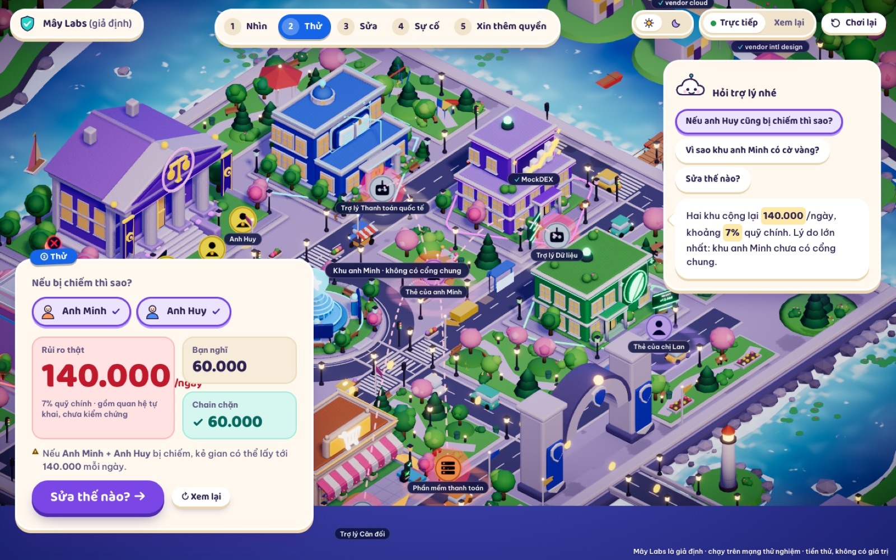
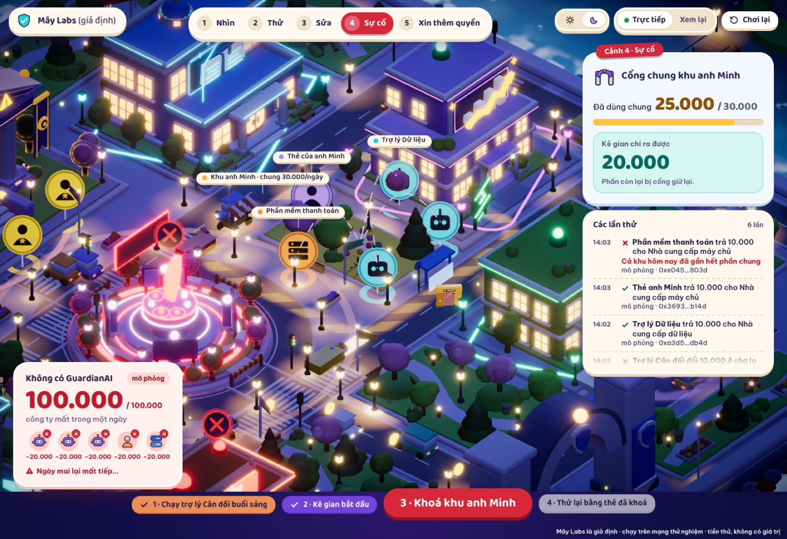
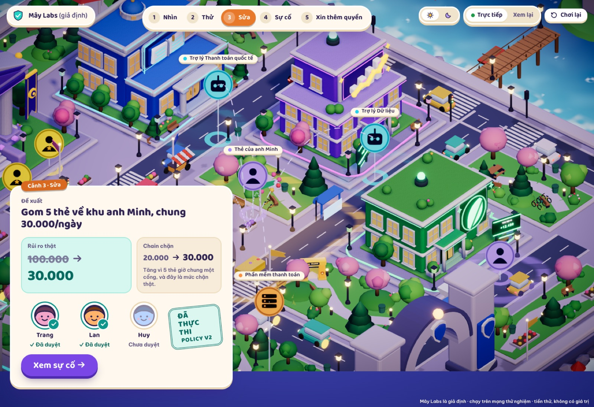
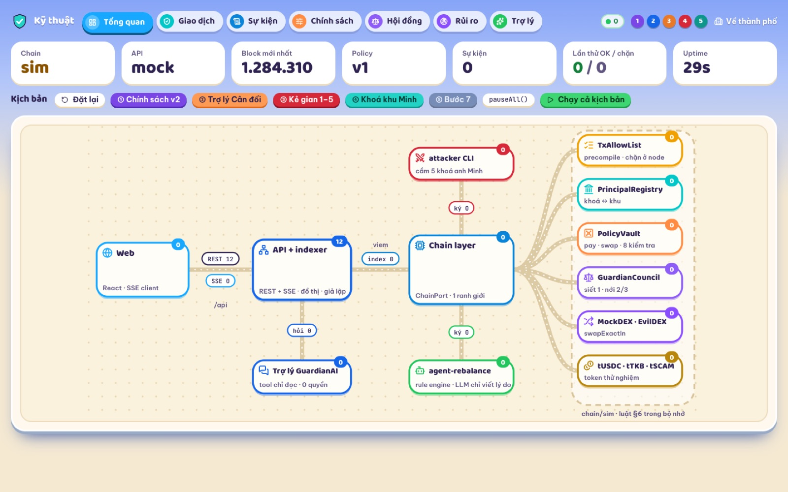
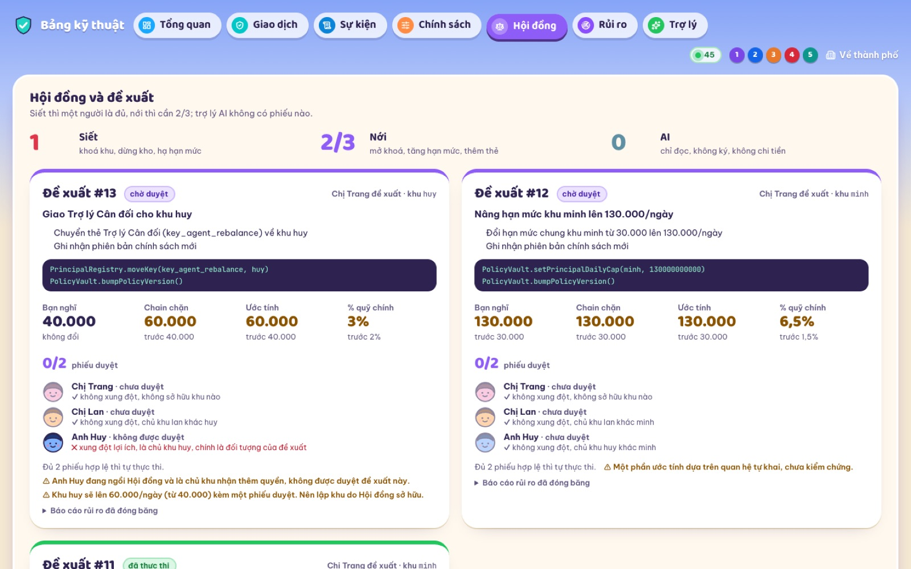

# Cordon

**Cordon** cho thấy ai thật sự nắm chìa khoá của từng khoản chi, mô phỏng thiệt hại nếu một chìa bị chiếm, rồi dựng "hàng rào" ngay ở tầng giao thức: hạn mức ngày dùng chung cho mỗi người, danh sách trắng đích đến, và công tắc khoá khẩn cấp trên một Avalanche L1. Trợ lý AI chỉ đọc dữ liệu, không bao giờ ký hay chuyển tiền.

**Demo trực tuyến:** https://nostidus4.github.io/Cordon/ (chạy hoàn toàn trong trình duyệt với chain giả lập, không cần server).

## Năm cảnh

1. **Nhìn:** thành phố 3D thể hiện ai giữ chìa nào, tòa nào đang an toàn hay có rủi ro.
2. **Thử:** giả lập một thẻ bị chiếm và so sánh "bạn nghĩ", "chain thật sự chặn" và ước tính thiệt hại.
3. **Sửa:** đề xuất chính sách mới, hội đồng duyệt, hạn mức dùng chung được áp dụng.
4. **Sự cố:** kẻ tấn công thử rút tiền, giao dịch bị chặn, khoá khẩn cấp được bật rồi phục hồi.
5. **Xin thêm quyền:** yêu cầu nâng quyền được so sánh trước/sau trước khi hội đồng quyết định.

| Thử | Sự cố | Sửa |
|---|---|---|
|  |  |  |

Bảng điều khiển kỹ thuật (`/he-thong/*`) dành cho kỹ sư:

| Tổng quan | Hội đồng |
|---|---|
|  |  |

## Công nghệ

| Phần | Công nghệ |
|---|---|
| Frontend | React, Vite, TypeScript, Tailwind, React Flow, three.js / react-three-fiber |
| Backend | FastAPI, uv, chain giả lập chạy trong bộ nhớ (`CHAIN_MODE=sim`) |
| Thành phố 3D | Script Blender `bpy` (`Blender/scripts/`), xuất `.glb` vào `Frontend/public/models/city/` |
| Hạ tầng | Docker Compose, GitHub Actions (CI + GitHub Pages), pre-commit |

## Cấu trúc thư mục

| Thư mục | Nội dung |
|---|---|
| `Backend/` | API FastAPI, đồ thị, mô phỏng, trợ lý đọc-chỉ, agent Cân đối, attacker CLI, chain giả lập |
| `Frontend/` | Giao diện thành phố 3D, bảng điều khiển kỹ thuật, backend giả lập chạy trong trình duyệt |
| `Blender/` | Script dựng 8 công trình, file `.blend` nguồn |
| `docs/` | Tài liệu phát triển và ảnh minh hoạ |

## Chạy thử

Cần `uv`, Node 22 và (tuỳ chọn) Docker.

    make setup      # cài phụ thuộc Backend + Frontend, hook pre-commit
    make dev-web    # giao diện tại http://localhost:5173 (mặc định dùng backend giả lập trong trình duyệt)
    make dev-api    # API FastAPI tại http://localhost:8000 (dùng với VITE_API_MODE=live)
    docker compose up --build -d   # api :8000, web :8080

## Kiểm thử

    make test       # pytest (Backend) + vitest (Frontend)
    make lint       # ruff, eslint, tsc

Chi tiết xem [docs/DEVELOPMENT.md](docs/DEVELOPMENT.md).

## Trạng thái và giới hạn

- Chain là **giả lập** trong bộ nhớ; hash giao dịch được gắn nhãn `simulated`.
- Smart contract (Foundry) và genesis Guardian L1 **chưa có** trong repo; khi có sẽ thêm adapter cùng giao diện `ChainPort`, API và UI giữ nguyên.
- Dữ liệu mẫu là hư cấu ("Mây Labs").

## Giấy phép

Bản quyền thuộc Nostidus4, bảo lưu mọi quyền. Mã nguồn chỉ để xem trên GitHub; xem [LICENSE](LICENSE).
